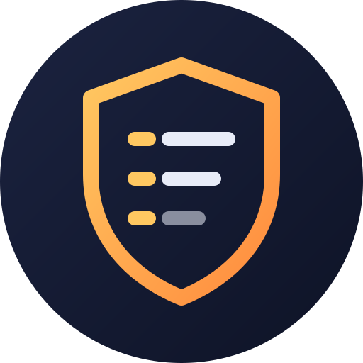

# Logwarden
**Every change in your server, on the record.** An open source Discord logging bot.

> Logwarden is based on [HDR/OpenLoggerBot](https://github.com/HDR/OpenLoggerBot) by HDR, licensed under GPL-3.0.
> This version adds bug fixes (see [Changes in this version](#changes-in-this-version)) and pm2 hosting.

## Add the bot to your server
**[➕ Invite the bot](https://discord.com/oauth2/authorize?client_id=1572432117311340676&scope=bot+applications.commands&permissions=117920)**

Then run `/setchannel #your-log-channel`. Every event is logged by default; turn off any you don't want with `/config <event> false`.

- [Terms of Service](TOS.md)
- [Privacy Policy](Privacy%20Policy.md)

## External Tools
[.log file viewer (from the original OpenLoggerBot)](https://martinrefseth.com/olb/logview/)

## Installation
### Requirements:
- [NodeJS](https://nodejs.org)
- [A Discord Application](https://discord.com/developers/applications)

### Setup:
1. `git clone https://github.com/ringnetcpbx/logwarden.git Logwarden`
2. `cd Logwarden`
3. Copy `config-example.json` to `config.json` and put in your bot `token`
4. `npm install`
5. Start it:
   - with pm2 (recommended, keeps it running): `pm2 start ecosystem.config.js && pm2 save`
   - or directly: `node index.js`

To update later: `git pull && npm install && pm2 restart logwarden`

### Making your own copy public
1. In the [Discord Developer Portal](https://discord.com/developers/applications), on the **Bot** tab, turn on **Public Bot** and all three **Privileged Gateway Intents**.
2. Invite link (replace `YOUR_APP_ID`):
   `https://discord.com/oauth2/authorize?client_id=YOUR_APP_ID&scope=bot+applications.commands&permissions=117920`
3. Above 100 servers Discord requires verification and intent approval, and links to your Terms of Service and Privacy Policy.

### Changes in this version
- Fixed a crash when a server's settings row is missing (`/setchannel` could create an empty table, so every event crashed the bot).
- `/config` now only accepts the listed event names (it previously put any text typed into the database query).
- Slash command registration no longer wipes other commands on the same bot token (e.g. a modmail bot).
- Added `ecosystem.config.js` for pm2.
- A server's saved settings are deleted when the bot is removed from it.
- Website with Terms of Service and Privacy Policy in `docs/` (for GitHub Pages).
- Use `clientReady` instead of the deprecated `ready` event.

## Commands
- To get started run `/setchannel <#channel>`
- All events are logged by default, this can be changed via the `/config` command 

**Example Usage:**
- `/config channelCreate false` (This would cause the bot to stop logging channelCreate events)

**Both commands require the manage server permission**

## Permissions
* This section is used to explain why we use certain permissions, Discord seemingly bundles random permissions for no good reason

| Permission           | Purpose                                |
|----------------------|----------------------------------------|
| Manage Server        | Required to log invite usage           |
| View Audit Log       | Required to get data for event logging |
| Read Messages        | Required to view public channels       |
| Send Messages        | Required to post logs                  |
| Embed Links          | Required to embed media                |
| Attach Files         | Required to log bulk deleted messages  |
| Read Message History | Required to read messages              |

## Configuration
- Usage:
    `/config <eventName> <true/false>`

  | Event | Details                                                         |
  |---------------------|-----------------------------------------------------------------|
  | channelCreate       | Triggered when a channel is created                             |
  | channelDelete       | Triggered when a channel is deleted                             |
  | channelUpdate       | Triggered when a channel is updated                             |
  | guildBanAdd         | Triggered when a user is banned                                 |
  | guildBanRemove      | Triggered when a user is unbanned                               |
  | guildEmojiCreate    | Triggered when an emoji is created                              |
  | guildEmojiDelete    | Triggered when an emoji is deleted                              |
  | guildEmojiUpdate    | Triggered when an emoji is updated                              |
  | guildInviteCreate   | Triggered when an invite is created                             |
  | guildMemberAdd      | Triggered when a member joins                                   |
  | guildMemberRemove   | Triggered when a member leaves                                  |
  | guildMemberOnboarding | Triggered when a member clears onboarding                       |
  | guildMemberUpdate   | Triggered when a member is update                               |
  | guildRoleCreate     | Triggered when a role is created                                |
  | guildRoleDelete     | Triggered when a role is deleted                                |
  | guildRoleUpdate     | Triggered when a role is updated                                |
  | guildStickerCreate  | Triggered when a sticker is created                             |
  | guildStickerDelete  | Not Triggered when a sticker is deleted                         |
  | guildStickerUpdate  | Triggered when a sticker is updated                             |
  | guildUpdate         | Triggered when the guild is updated                             |
  | messageBulkDelete   | Triggered when a bot deleted bulk messages or a user is banned  |
  | messageDelete       | Triggered when a message is deleted                             |
  | messageDeleteAttachments | Triggered when a message that has attachments is deleted        |
  | messageUpdate       | Triggered when a message is updated                             |
  | voiceStateUpdate    | Triggered when a  user joins, leaves or moves in a voice channel |

## Supported Events
* These are the events we can log

| Event                     | State           |
|---------------------------|-----------------|
| AutoModerationRuleCreate  | Not Implemented |
| AutoModerationRuleDelete  | Not Implemented |
| AutoModerationRuleUpdate  | Not Implemented |
| GuildMemberAdd            | Implemented     |
| GuildMemberRemove         | Implemented     |
| GuildMemberUpdate         | Implemented     |
| GuildRoleCreate           | Implemented     |
| GuildRoleDelete           | Implemented     |
| GuildRoleUpdate           | Implemented     |
| GuildEmojiCreate          | Implemented     |
| GuildEmojiDelete          | Implemented     |
| GuildEmojiUpdate          | Implemented     |
| GuildBanAdd               | Implemented     |
| GuildBanRemove            | Implemented     |
| ChannelCreate             | Implemented     |
| ChannelDelete             | Implemented     |
| ChannelUpdate             | Implemented     |
| ChannelPinsUpdate         | Not Implemented |
| MessageCreate             | Implemented     |
| MessageDelete             | Implemented     |
| MessageUpdate             | Implemented     |
| MessageBulkDelete         | Implemented     |
| VoiceStateUpdate          | Implemented     |
| GuildStickerCreate        | Implemented     |
| GuildStickerDelete        | Implemented     |
| GuildStickerUpdate        | Implemented     |
| GuildScheduledEventCreate | Not Implemented |
| GuildScheduledEventUpdate | Not Implemented |
| GuildScheduledEventDelete | Not Implemented |

## Credits

- [Androz2091](https://github.com/Androz2091/) for his [Invite Tracker](https://github.com/Androz2091/discord-invites-tracker)
- [Zipplet](https://github.com/zipplet) for helping me test OpenLoggerBot
- [JetBrains](https://www.jetbrains.com/?from=DMG-Bot) for providing a non-commercial open source licence to their products
- Inspired by [Logger](https://logger.bot/)
- **Claude AI** Claude assisted by getting the GitHub Pages up and getting the logo created.
